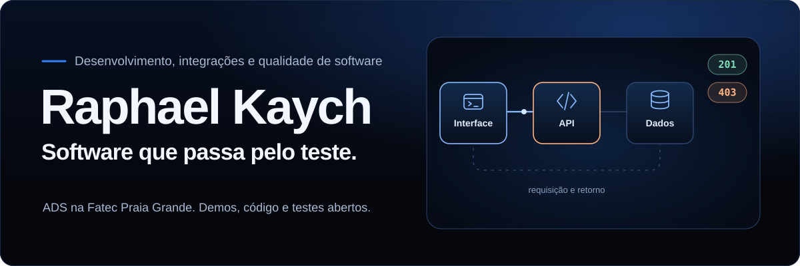

Estudo Análise e Desenvolvimento de Sistemas na Fatec Praia Grande. Desenvolvo aplicações, APIs e integrações, e escrevo os testes que provam que elas funcionam. A experiência sustentando sistemas em produção orienta os laboratórios abaixo: cada um roda no navegador e tem código e testes abertos.

**[Portfólio](https://raphael-kaych.raphaelkaych.workers.dev/)** · **[Executar uma demo](https://raphael-kaych.raphaelkaych.workers.dev/qualitygate)** · [Developer Workspace](https://raphael-kaych.raphaelkaych.workers.dev/workspace) · [Currículo online](https://raphael-kaych.raphaelkaych.workers.dev/trajetoria)

### Projetos em destaque

Cada projeto parte de um problema de integração ou qualidade e chega a um resultado que um teste confirma.

| Projeto | O problema | O que o teste comprova | Abrir |
| --- | --- | --- | --- |
| **QualityGate Studio** Quality engineering | Uma reserva pode responder 201 e ainda deixar saldo negativo ou um recibo a mais. | Um leitor que grava uma reserva recebe 403 na referência e 201 na variante defeituosa. O CI exige que essa falha apareça. [`laboratorios.spec.ts`](https://github.com/raphaelkaych/farol-de-integracoes/blob/main/e2e/laboratorios.spec.ts) | [Demo](https://raphael-kaych.raphaelkaych.workers.dev/qualitygate) · [Caso](https://raphael-kaych.raphaelkaych.workers.dev/projetos/qualitygate-studio) · [Código](https://github.com/raphaelkaych/farol-de-integracoes/tree/main/lib/qualitygate) |
| **ContractShield** Qualidade e segurança de APIs | Uma API pode vazar o registro de outra organização ou criar dois recursos para o mesmo reenvio. | Dois POST concorrentes com a mesma chave devolvem um único ID. A leitura de outro escopo devolve 404. [`contractshield.spec.ts`](https://github.com/raphaelkaych/farol-de-integracoes/blob/main/e2e/contractshield.spec.ts) | [Demo](https://raphael-kaych.raphaelkaych.workers.dev/contractshield) · [Caso](https://raphael-kaych.raphaelkaych.workers.dev/projetos/contractshield) · [Código](https://github.com/raphaelkaych/farol-de-integracoes/tree/main/lib/contractshield) |
| **LedgerFlow** Full stack e dados | Extrato e sistema descrevem a mesma operação com datas, reenvios e referências diferentes. | Um reenvio idêntico do extrato é reconhecido, e um ID com valores diferentes rejeita a importação inteira com 409. [`ledgerflow.test.ts`](https://github.com/raphaelkaych/farol-de-integracoes/blob/main/tests/ledgerflow.test.ts) | [Demo](https://raphael-kaych.raphaelkaych.workers.dev/ledgerflow) · [Caso](https://raphael-kaych.raphaelkaych.workers.dev/projetos/ledgerflow) · [Código](https://github.com/raphaelkaych/farol-de-integracoes/tree/main/lib/ledgerflow) |
| **TraceAtlas** Observabilidade | Um pedido lento atravessa API, banco e ERP, e o log de cada serviço conta só uma parte. | No cenário de banco lento, o rastro aponta o banco como gargalo sem misturar simulação e medição. [`traceatlas.test.ts`](https://github.com/raphaelkaych/farol-de-integracoes/blob/main/tests/traceatlas.test.ts) | [Demo](https://raphael-kaych.raphaelkaych.workers.dev/traceatlas) · [Caso](https://raphael-kaych.raphaelkaych.workers.dev/projetos/traceatlas) · [Código](https://github.com/raphaelkaych/farol-de-integracoes/tree/main/lib/traceatlas) |
| **Farol de Integrações** Confiabilidade de integrações | Quando o ERP cai, cada pedido precisa de um destino: nova tentativa, quarentena ou entrega. | Com o ERP instável, o pedido é entregue no terceiro envio, após 30 e 60 segundos de espera. [`farol.test.ts`](https://github.com/raphaelkaych/farol-de-integracoes/blob/main/tests/farol.test.ts) | [Demo](https://raphael-kaych.raphaelkaych.workers.dev/farol) · [Caso](https://raphael-kaych.raphaelkaych.workers.dev/projetos/farol-de-integracoes) · [Código](https://github.com/raphaelkaych/farol-de-integracoes/tree/main/lib/farol) |

### Outros laboratórios

- **[Radar de Retorno](https://raphael-kaych.raphaelkaych.workers.dev/radar-de-retorno)**: um HTTP 200 pode trazer um corpo que o fluxo não deveria aceitar. O Radar valida código e conteúdo juntos com Zod.
- **[Ponte ERP](https://github.com/raphaelkaych/ponte-erp)**: webhook com HMAC e deduplicação na mesma transação. Reenvios concorrentes criam um único pedido. [Demo](https://raphael-kaych.raphaelkaych.workers.dev/demos/ponte-erp)
- **[Pulso da Operação](https://github.com/raphaelkaych/pulso-operacao)**: recortes de SLA em SQL mostram que a fila com mais chamados nem sempre é a que pede atenção primeiro. [Relatório](https://raphael-kaych.raphaelkaych.workers.dev/demos/pulso-operacao)
- **[Plantão de TI](https://github.com/raphaelkaych/plantao-ti)**: fila de incidentes ordenada pelo prazo de resolução, com fechamento que não pode ser repetido. [Demo](https://raphael-kaych.raphaelkaych.workers.dev/demos/plantao-ti)

### Trajetória

- **[Vindex Fiscal](https://raphael-kaych.raphaelkaych.workers.dev/trajetoria#vindex-fiscal)**: participei do desenvolvimento em equipe do Vindex Fiscal, projeto de integração com a Secretaria da Fazenda (SEFAZ).
- **Projeto Casa**: TCC na ETEC, um projeto com Arduino e aplicativo para apoiar a comunicação de pessoas autistas. A pessoa seleciona uma imagem no app. O dispositivo acende luzes, exibe a imagem e fala o que foi mostrado. A neuropsicóloga Karen Baldin reconheceu o projeto pelo seu potencial de apoio à comunicação.
- **[SaaSTickets](https://saastickets.ai/)**: meu projeto na área de atendimento, com versão publicada.

**Experiência:** Analista de Sistemas na Estoril Renault, Coordenador de Projetos de TI na G2 Tecnologia e Analista de TI na Mar Brasil Serviços e Locações. **Formação:** Análise e Desenvolvimento de Sistemas na Fatec Praia Grande (em andamento) e Técnico em Informática na ETEC de Praia Grande. [Currículo completo](https://raphael-kaych.raphaelkaych.workers.dev/trajetoria)

Os laboratórios usam TypeScript, React, Python e SQL. Cada push no portfólio passa por lint, tipos, testes de lógica, navegador, acessibilidade e regressão visual no [GitHub Actions](https://github.com/raphaelkaych/farol-de-integracoes/actions/workflows/validar.yml).
