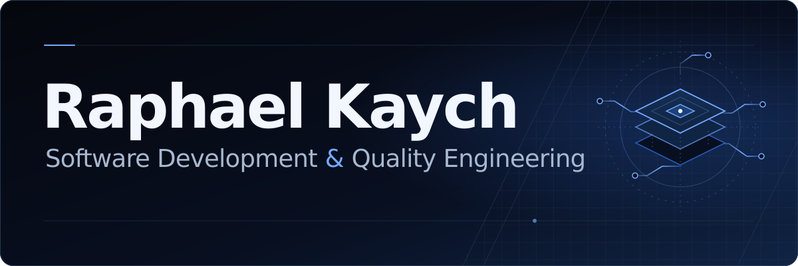

Estudo Análise e Desenvolvimento de Sistemas na Fatec Praia Grande. Minha trajetória em sustentação e integração de sistemas orienta os projetos que construo em desenvolvimento full stack, APIs e automação de testes.

**[Portfólio e demonstrações](https://raphael-kaych.raphaelvindex.chatgpt.site/)** · [Resumo profissional](https://raphael-kaych.raphaelvindex.chatgpt.site/trajetoria)

### Projetos em destaque

| Projeto | Evidência de engenharia | Acessos |
| --- | --- | --- |
| QualityGate Studio | Uma API compara a reserva de referência com falhas injetadas. Playwright registra a evidência da violação. | [Demo](https://raphael-kaych.raphaelvindex.chatgpt.site/qualitygate) · [Caso](https://raphael-kaych.raphaelvindex.chatgpt.site/projetos/qualitygate-studio) · [Código](https://github.com/raphaelkaych/farol-de-integracoes/tree/main/lib/qualitygate) |
| LedgerFlow | Conciliação de extratos fictícios com CSV, permissão por sessão e escrita com auditoria no D1. | [Demo](https://raphael-kaych.raphaelvindex.chatgpt.site/ledgerflow) · [Caso](https://raphael-kaych.raphaelvindex.chatgpt.site/projetos/ledgerflow) · [Código](https://github.com/raphaelkaych/farol-de-integracoes/tree/main/lib/ledgerflow) |
| Farol de Integrações | Retentativas, quarentena, concorrência e recuperação de um evento com histórico. | [Demo](https://raphael-kaych.raphaelvindex.chatgpt.site/farol) · [Caso](https://raphael-kaych.raphaelvindex.chatgpt.site/projetos/farol-de-integracoes) · [Código](https://github.com/raphaelkaych/farol-de-integracoes) |

### Outros laboratórios

- [Ponte ERP](https://github.com/raphaelkaych/ponte-erp) exercita webhooks assinados e reenvios idempotentes. [Estudo de caso](https://raphael-kaych.raphaelvindex.chatgpt.site/projetos/ponte-erp)
- [Pulso da Operação](https://github.com/raphaelkaych/pulso-operacao) calcula recortes de SLA com SQL. [Estudo de caso](https://raphael-kaych.raphaelvindex.chatgpt.site/projetos/pulso-operacao)
- [Plantão de TI](https://github.com/raphaelkaych/plantao-ti) modela a triagem por prazo de resolução. [Estudo de caso](https://raphael-kaych.raphaelvindex.chatgpt.site/projetos/plantao-ti)

Uso TypeScript, React, Python e SQL nos laboratórios. As execuções públicas mostram os testes de domínio, integração e navegador. [GitHub Actions](https://github.com/raphaelkaych/farol-de-integracoes/actions/workflows/validar.yml)
